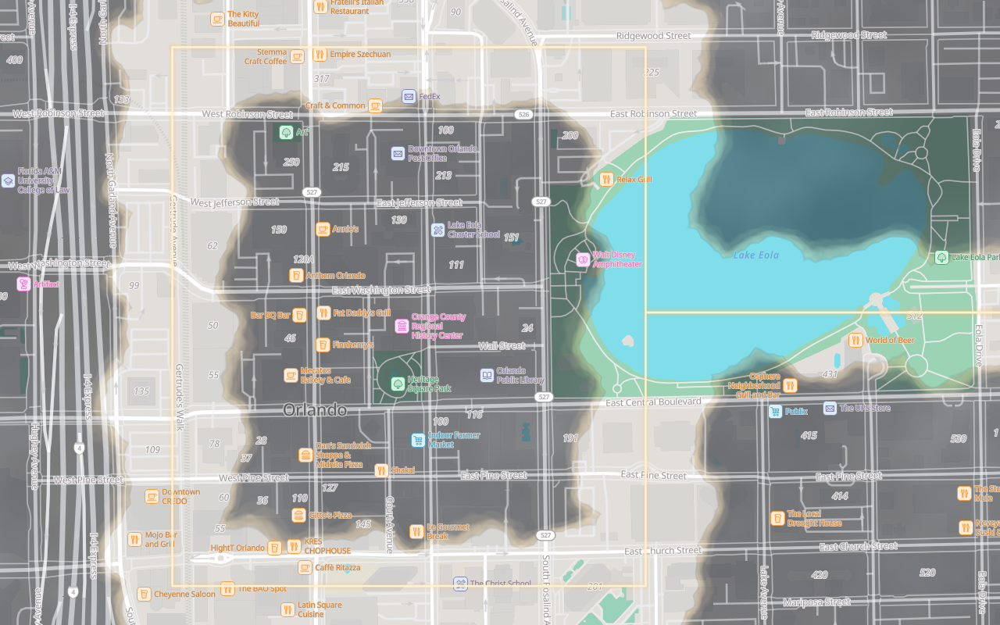
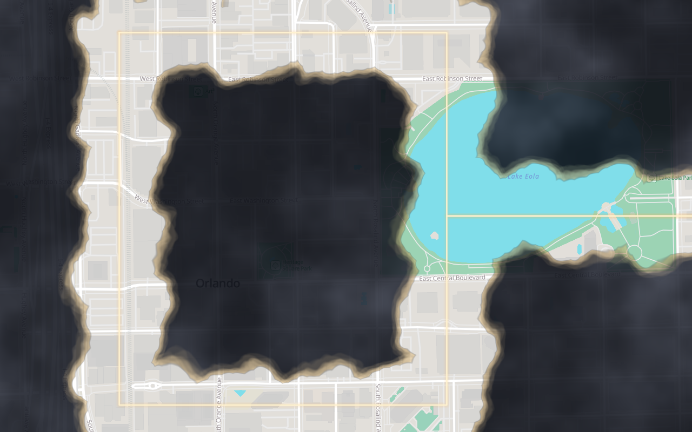

# 15-two-map-modes-and-cold-territory

> **Stub, generated during backlog validation.** The authoritative design is the
> `#### \`15-two-map-modes-and-cold-territory\`` section of [`../09-roadmap.md`](../09-roadmap.md). This file is where the
> DESIGN step's output belongs, and where [`AUDIT.md`](AUDIT.md) results are appended at close.

## Tickets (5)

- `0097` — Fork @protomaps/basemaps light into the parchment style, in two variants *(colours reverted to stock, D-373)*
- `0098` — The atlas / adventure toggle — uniforms, style variants, 320 ms cross-fade
- `0099` — What the modes may NOT differ in — revealed set and geometry parity, enforced
- `0100` — Cold territory wash, atlas mode only, on a different perceptual channel
- `0101` — Map controls, gestures, and inspecting a past run over the fog

## Design notes

_Filled in at the DESIGN step, before TICKET-WRITE._

### `0097` — the basemap, sampled

Forked from `@protomaps/basemaps@5.7.2`, flavour `light` (`lib/basemap-style.ts`). **Both variants
paint the stock `light` colours unchanged (D-373).** A parchment recolouring through `--map-*`
tokens shipped first and was rejected by the operator — it read as a filter over the map, and the
fog already carries the atmosphere — so D-373 supersedes D-053's parchment ground and D-369. What
the fork still owns is structure: adventure's reduced label density, and atlas's labels and
0.5-opacity road-fill copies above the fog (D-368). D-053's refusal of a *dark* basemap stands: the
stock ground is light and nearly neutral, so the fog does the darkening.

The values below are the stock flavour's, sRGB → CIELAB (D65), the metric D-371 fixes;
`basemap-style.test.ts` re-asserts the thresholds on every build. They are identical in both
variants, since the variants no longer differ in colour.

| Sample | sRGB | L\* | C\* | CIELAB sat. | HSV sat. | HSL sat. |
|---|---|---|---|---|---|---|
| Ground (`earth`, the land fill) | 226, 223, 218 | **88.9** | 2.8 | **3.1%** | 3.5% | 12.1% |
| Background (where no tile is loaded) | 204, 204, 204 | **82.0** | 0.0 | **0.0%** | 0.0% | 0.0% |

Both pass the criterion: L\* ≥ 80 and CIELAB saturation ≤ 25%. Water (`#80deea`, L\* 83.3, 32.7%)
is not ground and the criterion does not bind it.

**The saturation metric is CIELAB saturation, C\* / √(C\*² + L\*²), with HSV reported beside it.
HSL was rejected** (operator, `0097`, D-371): HSL saturation divides by `1 − |2L − 1|`, which goes
to zero near white, so any faintly tinted near-white reads as strongly saturated — the parchment
ground `--parch-100` measured 58% under HSL while looking almost neutral.

The parchment version's water-vs-trace ΔE table and its "paper grain not built" note are gone with
the parchment (D-373): stock water is cyan, not an ink wash, and there is no paper to grain.

### `0099` — what the modes may not differ in, measured

05 §5.4: neither mode changes what is revealed, and neither changes scoring. The proof has four
parts. Each one has a sabotage case that must fail.

| | What is proved | Where | Sabotage |
|---|---|---|---|
| Mask parity | The coverage mask (the 0.5× offscreen buffer that decides what is revealed) is **bit-identical** in atlas, adventure, mid-fade and back. Checked at z12, z15.25 and z17.75, through the real `swapBasemap` + `setPalette` on a real Map, with the mask redrawn fresh in each mode. | `tools/fog-harness/run-mode-swap.mjs` | A ⅛-mask-pixel camera move changes 4,763 / 7,741 / 23,107 bytes |
| Same GL calls | The mask pass makes the same calls in every mode. A mode change never re-runs it; only the composite redraws. | `lib/fog/mode-parity.test.ts` (`npm test`) | A 0.01-zoom camera change gives a different call stream |
| No mode argument | No parameter of the cell-selection or `revealScale` paths is, or contains, a mode, a palette or `"atlas"`/`"adventure"`, per the TypeScript checker. None of those modules imports anything that defines one. | `lib/fog/mode-parity.test.ts` | A `look: "atlas" \| "adventure"` parameter added to `cullBucket` fails it. `FogMaskLayer`'s constructor is caught by the same walker. |
| Name boundary | The mode's identifiers appear only in the renderer, the toggle and the run-moment seam. A hit in `src/`, `amplify/` or the rest of `app/` and `lib/` fails the build. | `scripts/check-mode-boundary.mjs` (Amplify + gate) | 17 self-test cases; no exemptions (`0296`) |

Mask hashes from the harness run (FNV-1a over RGBA, 640×400). Each row was equal across adventure,
atlas, mid-fade and back to adventure:

| Zoom | Mask hash | Revealed / fogged / edge px |
|---|---|---|
| z12 | `ceff5b97` | 15,183 / 225,587 / 15,230 |
| z15.25 | `7d8bfde6` | 122,032 / 126,000 / 7,968 |
| z17.75 | `a9ac8d89` | 23,644 / 195,641 / 36,715 |

**The ghost grid** (05 §5.3, criterion 4). Nothing is explored, so every pixel is fog at
`u_maxOpacity`, and every label is hidden. Δ = mean luminance of road pixels minus mean luminance of
the ground between them, high-passed (13 px box) so that the fBm's large blotches cancel. Measured on
the same frames, 8-bit luma (`tools/fog-harness/mode-parity-shots.mjs`, stock `light` ground, D-373):

| `u_maxOpacity` | z15 Δ | z16 Δ |
|---|---|---|
| atlas 0.55 (road copy above fog, D-368) | 43.92 | 40.87 |
| adventure 0.90 (shipped) | **1.98** | **1.85** |
| adventure 0.94 (the ceiling) | **1.19** | **1.11** |
| sabotage: 1.0 | −0.01 | −0.01 |

At the ceiling the street grid still shows through, and at 1.0 it is gone. This is the margin that
D-051 rests on in adventure: about one grey level at the ceiling, two at the shipped value.

**Street-name legibility** (criterion 5, roadmap §9.5). This covers the `roads_labels*` layers at
z15–z16 over the synthetic downtown loop. Each label is measured as the WCAG ratio of its letters'
solid core (the darkest tenth of its glyph pixels) against the median of the 2 px ring around them
in the shipped frame, which is the halo plus the ground just past it. Rows give the median, with p10
and the label count in brackets. "No fog" is the stock map.

| Mode | Ground | z15 | z16 |
|---|---|---|---|
| atlas | no fog (stock) | 2.03:1 (1.94, n 59) | 2.01:1 (1.95, n 29) |
| atlas | revealed | **2.03:1 — 1.00× stock** | **2.01:1 — 1.00× stock** |
| atlas | unexplored (names above fog, D-368) | **1.55:1 — 0.77× stock** (1.43, n 62) | **1.46:1 — 0.73× stock** (1.37, n 29) |
| adventure | no fog (stock) | 2.05:1 (1.93, n 34) | 2.01:1 (1.94, n 22) |
| adventure | revealed | **2.05:1 — 1.00× stock** | **2.01:1 — 1.00× stock** |
| adventure | unexplored (names under fog, by design) | 1.22:1 (n 1 detectable) | 1.12:1 (n 6 detectable) |

- **Revealed ground is identical to the stock map in both modes.** The fog takes nothing there. Both
  modes' street names on known ground read exactly as the unfogged basemap does.
- **Atlas keeps street names over unexplored ground, at about three-quarters of stock contrast.**
  The stock `light` halo is thin. The fog darkens what lies just past it, so the ring the eye reads
  against is darker than on open ground. No design doc sets a floor for this number, so it is
  recorded here as a finding (ticket `0099`'s Resolution) and not judged.
- **Adventure hides names over unexplored ground, by design** (05 §5.3). Its D-051 guarantee is the
  ghost grid above, not the names.
- The stock map itself measures about 2:1 by this method. Its label fill `#938a8d` on a `#ffffff`
  halo is 3.4:1 by colour. A street-name glyph at this size is mostly antialiased edge, and its
  solid core never reaches the full fill colour.

**The same viewport in each mode** (criterion 6). z16, the synthetic loop, with each mode reached
through the toggle's own swap from the other. The revealed ground is the same in both frames:

## Audit

_Appended by `/tickets audit` at close. See [`AUDIT.md`](AUDIT.md)._

## Reflection

_Filled in at the REFLECT step, after USE._

